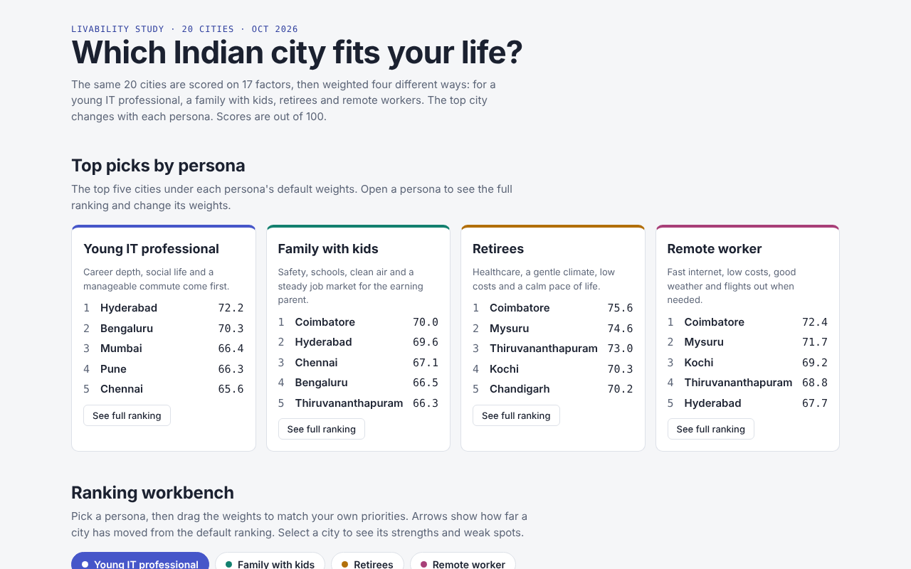

# India City Livability Index

20 Indian cities rated on 17 factors and ranked for four kinds of people. Drag the weights and watch the ranking change.

**Live:** https://vishwadeep-solves-conflicts.github.io/india-livability-index/

## What's in it

- **Four personas** with their own weights: for example, retirees put 18% on healthcare and nothing on jobs, while remote workers put 15% on internet and nothing on commute.
- **A ranking you can tune:** change any weight and the order updates.
- **Strengths and weak spots** for each city, compared with the 20-city median.
- **A heatmap** of every factor score for every city.

## Method and limits

Each factor is a 1–10 rating drawn from public indicators available through mid-2026: CPCB air quality, NCRB crime rates, the TomTom traffic index, Swachh Survekshan ranks, Ookla speeds, IMD climate normals, NIRF institutions, and rent and price trackers. A persona score is the weighted average of the 17 ratings, scaled to 100.

Read with care:

- **The ratings are judgments, not live data.** They compress many sources into one number, and they'll drift as cities change.
- **Crime data has a reporting bias.** Cities where more people report crimes can look less safe than they are.
- **City boundaries vary.** Delhi, Gurugram and Noida are scored separately.
- **Smaller cities score well when jobs carry little weight.** That reverses quickly for anyone who needs a local job.

Corrections are welcome: open an issue with a source.

## Run it locally

It's one HTML file with no dependencies, so just open `index.html`. The scores live in the `CITIES` table in the script.

## Licence

MIT. Built by [Vishwadeep Kushwaha](https://vishwadeep-s.netlify.app).
